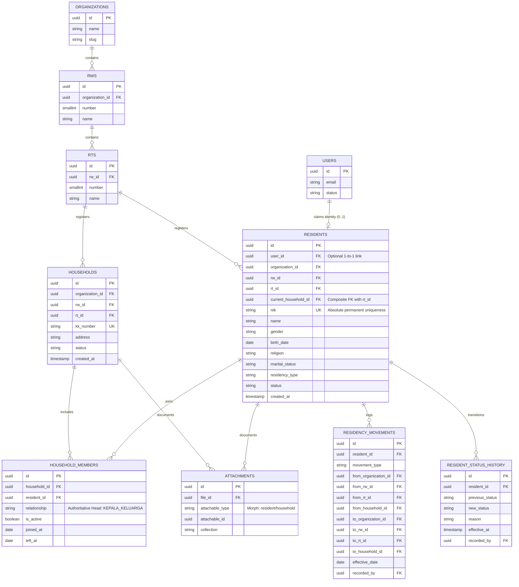

# Resident & Household Domain Architecture Specification v2.1

> **Document Status:** ARCHITECTURE SPECIFICATION v2.1 — FINAL READINESS REVIEW (DESIGN ONLY)  
> **Target System:** RT/RW Community Administration & Governance Platform  
> **Framework Stack:** Laravel 13 Modular Monolith | PostgreSQL 16+ | React 19 + TypeScript SPA  
> **Strict Boundary:** NO PRODUCTION CODE (migrations, models, controllers, UI) is implemented in this phase.

---

## 1. Final Architecture Decisions

Following the final readiness review, five key architectural decisions have been codified:

### Decision 1: Single Source of Truth for Head of Household (No Circular FKs)
- **Elimination of `households.head_of_household_id`:** In v2, `head_of_household_id` was retained on `households` as a denormalized reference. In v2.1, it is **removed from the schema**.
  - *Rationale:* Storing `head_of_household_id` on `households` while `residents.current_household_id` points to `households` introduced a **circular foreign key dependency**. Circular FKs require deferred constraints, complex migration sequencing (`ALTER TABLE ADD CONSTRAINT` after both tables exist), and create synchronization risks with `household_members`.
  - *Query Reality:* In PostgreSQL, querying a household's active head via `household_members` with a partial index (`WHERE relationship = 'KEPALA_KELUARGA' AND is_active = TRUE`) takes $< 0.1\text{ ms}$ (a single-row index scan). The minor denormalization benefit is vastly outweighed by the schema simplification.
  - *Canonical Authority:* `household_members.relationship = 'KEPALA_KELUARGA' AND is_active = TRUE` is the **single and exclusive source of truth**.

### Decision 2: Permanent and Absolute NIK Uniqueness
- **Permanent Identity Policy:** Under Indonesian Civil Law (UU No. 24/2013 on Adminduk), an individual's 16-digit NIK (Nomor Induk Kependudukan) is permanently assigned from birth/registration until death. Deceased NIKs are **never recycled or reassigned**.
- **Schema Rule:** Table-wide `CONSTRAINT residents_nik_unique UNIQUE (nik)` without any lifecycle filter.

### Decision 3: Clean Separation of Physical Movement vs Administrative Lifecycle
- **Residency Movement Ledger (`residency_movements`):** Tracks **only** geographical and domestic relocations (`MOVE_IN_EXTERNAL`, `MOVE_OUT_EXTERNAL`, `TRANSFER_INTERNAL`, `HOUSEHOLD_SPLIT`).
- **Resident Status History (`resident_status_history`):** A dedicated, append-only ledger tracking civil lifecycle state transitions (`PROSPECTIVE`, `ACTIVE`, `INACTIVE`, `MOVED`, `DECEASED`).
- Both ledgers are append-only and protected by native PostgreSQL triggers.

### Decision 4: Authoritative Status Vocabularies
- **Resident Status (5 States):** `PROSPECTIVE`, `ACTIVE`, `INACTIVE`, `MOVED`, `DECEASED`.
- **Household Status (5 States):** `ACTIVE`, `HEAD_VACANT`, `MOVED`, `DISSOLVED`, `ARCHIVED`.
- Perfectly unified across DDL, enums, state machines, and API contracts.

### Decision 5: Explicit Domain Commands over Generic CRUD
- High-impact lifecycle and organizational changes (relocations, verification, death recording, head changes) are exposed through explicit domain command endpoints (e.g. `POST /relocate`, `POST /verify`, `POST /mark-deceased`, `POST /change-head`), rejecting generic `PATCH` mutations on state columns.

---

## 2. Canonical Source of Truth Matrix

| Domain Concept | Canonical Source of Truth | Secondary / Derived Representation | Synchronization Mechanism |
| :--- | :--- | :--- | :--- |
| **Civil Identity** (NIK, Legal Name, Birth) | `residents` table | Auto-populated into Letters / Invoices | Read-time derivation from `residents` |
| **Head of Household** | `household_members` (`relationship = 'KEPALA_KELUARGA' AND is_active = TRUE`) | Inferred via `Household::activeHead` relation | Computed via SQL partial index; NO stored column |
| **Household Composition** | `household_members` | `residents.current_household_id` | Updated atomically inside `AssignResidentToHousehold` transaction |
| **Resident Organizational Scope** | `residents.rt_id` | Derives `rw_id` and `organization_id` | Enforced by composite FK `(current_household_id, rt_id)` |
| **Household Scope** | `households.rt_id` | Derives `rw_id` and `organization_id` | Enforced by composite FK `(rt_id, rw_id)` |
| **Geographical Movement History** | `residency_movements` | None | Append-only; trigger-protected |
| **Civil Lifecycle History** | `resident_status_history` | `residents.status` | State updated atomically when appending history row |
| **Authentication Identity** | `users` | `residents.user_id` (nullable 1-to-1) | Foreign key link; User lifecycle policy |
| **Administrative Authority** | `memberships` table | None (User's active roles/scopes) | `AccessResolver` evaluation |
| **Document Privacy & Scope** | `files` table | Polymorphic `attachments` | Governed by `StoredFilePolicy` |

---

## 3. Final Entity Model

### 3.1 Organization Hierarchy (Existing Foundation)
- **`organizations`:** Top-level community jurisdiction (e.g. Kelurahan / Perumahan complex).
- **`rws`:** Coordinating neighborhood unit (Rukun Warga). Composite target `(id, organization_id)`.
- **`rts`:** Operational municipal administrative unit (Rukun Tetangga). Composite target `(id, rw_id)`.

### 3.2 Resident & Household Core Entities
- **`households` (Kartu Keluarga Unit):**
  - Represents an administrative dwelling / family unit registered within an RT.
  - Attributes: `id`, `organization_id`, `rw_id`, `rt_id`, `kk_number` (16 digits), `address`, `status`, `notes`, timestamps.
  - **No `head_of_household_id` stored column** (resolved through `household_members`).
- **`residents` (Civil Individual):**
  - Represents a natural person residing in the administrative area.
  - Attributes: `id`, `user_id` (optional 1-to-1), `organization_id`, `rw_id`, `rt_id`, `current_household_id` (nullable), `nik` (16 digits, permanently unique), `name`, `gender`, `birth_place`, `birth_date`, `religion`, `marital_status`, `blood_type`, `occupation`, `education`, `phone`, `residency_type`, `status`, timestamps.
- **`household_members` (Family / Domicile Join Entity):**
  - Connects a resident to a household with an explicit civil role (SHDK).
  - Attributes: `id`, `household_id`, `resident_id`, `relationship`, `is_active`, `joined_at`, `left_at`, `left_reason`, timestamps.
- **`residency_movements` (Relocation Ledger):**
  - Append-only log of physical and household relocations.
  - Attributes: `id`, `resident_id`, `movement_type`, `from_organization_id`, `from_rw_id`, `from_rt_id`, `from_household_id`, `to_organization_id`, `to_rw_id`, `to_rt_id`, `to_household_id`, `effective_date`, `reference_letter_number`, `attachment_file_id`, `notes`, `recorded_by`, `created_at`.
- **`resident_status_history` (Civil Lifecycle Ledger):**
  - Append-only log of administrative status transitions.
  - Attributes: `id`, `resident_id`, `previous_status`, `new_status`, `reason`, `effective_at`, `reference_letter_number`, `attachment_file_id`, `recorded_by`, `created_at`.

---

## 4. Final Entity Relationship Diagram (ERD)



---

## 5. Final Database Contract (PostgreSQL 16+ DDL)

```sql
-- ============================================================================
-- 1. HOUSEHOLDS TABLE
-- ============================================================================
CREATE TABLE households (
    id UUID PRIMARY KEY DEFAULT gen_random_uuid(),
    organization_id UUID NOT NULL REFERENCES organizations(id) ON DELETE RESTRICT,
    rw_id UUID NOT NULL,
    rt_id UUID NOT NULL,
    kk_number VARCHAR(16) NOT NULL,
    address TEXT NOT NULL,
    status VARCHAR(20) NOT NULL DEFAULT 'ACTIVE',
    notes TEXT,
    created_at TIMESTAMP WITH TIME ZONE DEFAULT CURRENT_TIMESTAMP,
    updated_at TIMESTAMP WITH TIME ZONE DEFAULT CURRENT_TIMESTAMP,
    deleted_at TIMESTAMP WITH TIME ZONE,

    -- Composite foreign keys ensuring strict hierarchy
    CONSTRAINT households_rw_fk FOREIGN KEY (rw_id, organization_id)
        REFERENCES rws(id, organization_id) ON DELETE RESTRICT,
    CONSTRAINT households_rt_fk FOREIGN KEY (rt_id, rw_id)
        REFERENCES rts(id, rw_id) ON DELETE RESTRICT,

    -- Composite target for dependent tables (enforcing scope alignment)
    CONSTRAINT households_id_rt_unique UNIQUE (id, rt_id),

    -- Status validation check
    CONSTRAINT households_status_check CHECK (status IN ('ACTIVE', 'HEAD_VACANT', 'MOVED', 'DISSOLVED', 'ARCHIVED')),
    CONSTRAINT households_kk_number_format CHECK (kk_number ~ '^[0-9]{16}$')
);

-- Partial unique index: A KK number is unique per organization among ACTIVE households
CREATE UNIQUE INDEX households_active_kk_unique
ON households (organization_id, kk_number)
WHERE status = 'ACTIVE' AND deleted_at IS NULL;

CREATE INDEX households_rt_status_idx ON households (rt_id, status);


-- ============================================================================
-- 2. RESIDENTS TABLE
-- ============================================================================
CREATE TABLE residents (
    id UUID PRIMARY KEY DEFAULT gen_random_uuid(),
    user_id UUID UNIQUE REFERENCES users(id) ON DELETE SET NULL,
    organization_id UUID NOT NULL REFERENCES organizations(id) ON DELETE RESTRICT,
    rw_id UUID NOT NULL,
    rt_id UUID NOT NULL,
    current_household_id UUID,
    nik VARCHAR(16) NOT NULL,
    name VARCHAR(150) NOT NULL,
    gender VARCHAR(10) NOT NULL,
    birth_place VARCHAR(100) NOT NULL,
    birth_date DATE NOT NULL,
    religion VARCHAR(30) NOT NULL,
    marital_status VARCHAR(20) NOT NULL,
    blood_type VARCHAR(10) NOT NULL DEFAULT 'UNKNOWN',
    occupation VARCHAR(100),
    education VARCHAR(20) NOT NULL DEFAULT 'NONE',
    phone VARCHAR(25),
    residency_type VARCHAR(20) NOT NULL DEFAULT 'PERMANENT',
    status VARCHAR(20) NOT NULL DEFAULT 'PROSPECTIVE',
    created_at TIMESTAMP WITH TIME ZONE DEFAULT CURRENT_TIMESTAMP,
    updated_at TIMESTAMP WITH TIME ZONE DEFAULT CURRENT_TIMESTAMP,
    deleted_at TIMESTAMP WITH TIME ZONE,

    -- Composite foreign keys ensuring strict hierarchy
    CONSTRAINT residents_rw_fk FOREIGN KEY (rw_id, organization_id)
        REFERENCES rws(id, organization_id) ON DELETE RESTRICT,
    CONSTRAINT residents_rt_fk FOREIGN KEY (rt_id, rw_id)
        REFERENCES rts(id, rw_id) ON DELETE RESTRICT,

    -- COMPOSITE FOREIGN KEY ENFORCING RESIDENT & HOUSEHOLD RT SCOPE ALIGNMENT
    CONSTRAINT residents_household_rt_fk FOREIGN KEY (current_household_id, rt_id)
        REFERENCES households(id, rt_id) ON DELETE SET NULL,

    -- Target of composite FKs for dependent tables
    CONSTRAINT residents_id_rt_unique UNIQUE (id, rt_id),

    -- Invariant: Absolute NIK uniqueness across entire table (permanent identity)
    CONSTRAINT residents_nik_unique UNIQUE (nik),

    -- Check constraints
    CONSTRAINT residents_nik_format CHECK (nik ~ '^[0-9]{16}$'),
    CONSTRAINT residents_gender_check CHECK (gender IN ('MALE', 'FEMALE')),
    CONSTRAINT residents_residency_type_check CHECK (residency_type IN ('PERMANENT', 'TEMPORARY', 'SEASONAL')),
    CONSTRAINT residents_status_check CHECK (status IN ('PROSPECTIVE', 'ACTIVE', 'INACTIVE', 'MOVED', 'DECEASED')),
    CONSTRAINT residents_marital_status_check CHECK (marital_status IN ('SINGLE', 'MARRIED', 'DIVORCED', 'WIDOWED')),
    CONSTRAINT residents_birth_date_check CHECK (birth_date <= CURRENT_DATE)
);

CREATE INDEX residents_rt_status_idx ON residents (rt_id, status);
CREATE INDEX residents_household_idx ON residents (current_household_id);
CREATE INDEX residents_name_idx ON residents (name);


-- ============================================================================
-- 3. HOUSEHOLD MEMBERS TABLE
-- ============================================================================
CREATE TABLE household_members (
    id UUID PRIMARY KEY DEFAULT gen_random_uuid(),
    household_id UUID NOT NULL REFERENCES households(id) ON DELETE CASCADE,
    resident_id UUID NOT NULL REFERENCES residents(id) ON DELETE RESTRICT,
    relationship VARCHAR(30) NOT NULL,
    is_active BOOLEAN NOT NULL DEFAULT TRUE,
    joined_at DATE NOT NULL DEFAULT CURRENT_DATE,
    left_at DATE,
    left_reason VARCHAR(100),
    created_at TIMESTAMP WITH TIME ZONE DEFAULT CURRENT_TIMESTAMP,
    updated_at TIMESTAMP WITH TIME ZONE DEFAULT CURRENT_TIMESTAMP,

    CONSTRAINT household_members_relationship_check CHECK (
        relationship IN (
            'KEPALA_KELUARGA', 'SUAMI', 'ISTRI', 'ANAK',
            'MENANTU', 'CUCU', 'ORANG_TUA', 'MERTUA',
            'FAMILI_LAIN', 'PEMBANTU', 'LAINNYA'
        )
    ),
    CONSTRAINT household_members_dates_check CHECK (left_at IS NULL OR left_at >= joined_at)
);

-- Invariant: Exactly ONE active Head of Household per Household
CREATE UNIQUE INDEX household_single_active_head_unique
ON household_members (household_id)
WHERE relationship = 'KEPALA_KELUARGA' AND is_active = TRUE;

-- Invariant: A resident can belong to at most ONE active household at any time
CREATE UNIQUE INDEX resident_single_active_household_unique
ON household_members (resident_id)
WHERE is_active = TRUE;

CREATE INDEX household_members_active_idx ON household_members (household_id, is_active);


-- ============================================================================
-- 4. RESIDENCY MOVEMENTS TABLE (GEOGRAPHICAL RELOCATION LEDGER)
-- ============================================================================
CREATE TABLE residency_movements (
    id UUID PRIMARY KEY DEFAULT gen_random_uuid(),
    resident_id UUID NOT NULL REFERENCES residents(id) ON DELETE RESTRICT,
    movement_type VARCHAR(30) NOT NULL,
    from_organization_id UUID REFERENCES organizations(id) ON DELETE RESTRICT,
    from_rw_id UUID REFERENCES rws(id) ON DELETE RESTRICT,
    from_rt_id UUID REFERENCES rts(id) ON DELETE RESTRICT,
    from_household_id UUID REFERENCES households(id) ON DELETE SET NULL,
    to_organization_id UUID REFERENCES organizations(id) ON DELETE RESTRICT,
    to_rw_id UUID REFERENCES rws(id) ON DELETE RESTRICT,
    to_rt_id UUID REFERENCES rts(id) ON DELETE RESTRICT,
    to_household_id UUID REFERENCES households(id) ON DELETE SET NULL,
    effective_date DATE NOT NULL DEFAULT CURRENT_DATE,
    reference_letter_number VARCHAR(100),
    attachment_file_id UUID REFERENCES files(id) ON DELETE SET NULL,
    notes TEXT,
    recorded_by UUID NOT NULL REFERENCES users(id) ON DELETE RESTRICT,
    created_at TIMESTAMP WITH TIME ZONE DEFAULT CURRENT_TIMESTAMP,

    CONSTRAINT residency_movements_type_check CHECK (
        movement_type IN ('MOVE_IN_EXTERNAL', 'MOVE_OUT_EXTERNAL', 'TRANSFER_INTERNAL', 'HOUSEHOLD_SPLIT')
    )
);

CREATE INDEX residency_movements_resident_idx ON residency_movements (resident_id, effective_date DESC);

-- Native trigger enforcing append-only immutability
CREATE OR REPLACE FUNCTION residency_movements_prevent_mutation() RETURNS trigger AS $$
BEGIN
    RAISE EXCEPTION 'Residency movement records are append-only and cannot be altered or deleted.'
        USING ERRCODE = 'integrity_constraint_violation';
END;
$$ LANGUAGE plpgsql;

CREATE TRIGGER residency_movements_append_only
BEFORE UPDATE OR DELETE ON residency_movements
FOR EACH ROW EXECUTE FUNCTION residency_movements_prevent_mutation();


-- ============================================================================
-- 5. RESIDENT STATUS HISTORY TABLE (LIFECYCLE TRANSITION LEDGER)
-- ============================================================================
CREATE TABLE resident_status_history (
    id UUID PRIMARY KEY DEFAULT gen_random_uuid(),
    resident_id UUID NOT NULL REFERENCES residents(id) ON DELETE RESTRICT,
    previous_status VARCHAR(20) NOT NULL,
    new_status VARCHAR(20) NOT NULL,
    reason TEXT,
    effective_at TIMESTAMP WITH TIME ZONE DEFAULT CURRENT_TIMESTAMP,
    reference_letter_number VARCHAR(100),
    attachment_file_id UUID REFERENCES files(id) ON DELETE SET NULL,
    recorded_by UUID NOT NULL REFERENCES users(id) ON DELETE RESTRICT,
    created_at TIMESTAMP WITH TIME ZONE DEFAULT CURRENT_TIMESTAMP,

    CONSTRAINT resident_status_history_prev_check CHECK (
        previous_status IN ('PROSPECTIVE', 'ACTIVE', 'INACTIVE', 'MOVED', 'DECEASED')
    ),
    CONSTRAINT resident_status_history_new_check CHECK (
        new_status IN ('PROSPECTIVE', 'ACTIVE', 'INACTIVE', 'MOVED', 'DECEASED')
    )
);

CREATE INDEX resident_status_history_resident_idx ON resident_status_history (resident_id, effective_at DESC);

-- Native trigger enforcing append-only immutability
CREATE OR REPLACE FUNCTION resident_status_history_prevent_mutation() RETURNS trigger AS $$
BEGIN
    RAISE EXCEPTION 'Resident status history records are append-only and cannot be altered or deleted.'
        USING ERRCODE = 'integrity_constraint_violation';
END;
$$ LANGUAGE plpgsql;

CREATE TRIGGER resident_status_history_append_only
BEFORE UPDATE OR DELETE ON resident_status_history
FOR EACH ROW EXECUTE FUNCTION resident_status_history_prevent_mutation();
```

---

## 6. Final Invariant Matrix

| Invariant | Database Enforcement | Domain Service Enforcement | Policy Enforcement | Test Verification Requirement |
| :--- | :--- | :--- | :--- | :--- |
| **INV-01: Permanent NIK Uniqueness** | `CONSTRAINT residents_nik_unique UNIQUE (nik)` | Existence check prior to insert | Rejection handling | Reject duplicate NIK (including deceased) with `409 Conflict`. |
| **INV-02: NIK Format Validation** | CHECK `nik ~ '^[0-9]{16}$'` | `RegisterResidentRequest` regex validation | FormRequest validation | Malformed strings (letters, $\ne 16$ digits) rejected with `422`. |
| **INV-03: Active KK Format & Uniqueness** | CHECK format + `UNIQUE (org_id, kk_number) WHERE status = 'ACTIVE'` | `CreateHouseholdRequest` validation | FormRequest validation | Duplicate active KK registration rejected with `409 Conflict`. |
| **INV-04: Single Active Household Head** | `UNIQUE (household_id) WHERE relationship = 'KEPALA_KELUARGA' AND is_active = TRUE` | `ChangeHouseholdHeadAction` atomic transaction | `household.manage` | Direct SQL or concurrent second active head aborted by SQL engine. |
| **INV-05: Single Active Household per Resident** | `UNIQUE (resident_id) WHERE is_active = TRUE` | `AddHouseholdMemberAction` validation | `household.manage` | Adding active resident to another KK fails with `409 Conflict`. |
| **INV-06: Resident/Household Scope Alignment** | Composite FK `FOREIGN KEY (current_household_id, rt_id) REFERENCES households(id, rt_id)` | `AssignResidentToHousehold` checks `$res->rt_id === $hh->rt_id` | Scope check | Attempting to link resident of RT 03 to household of RT 02 aborted by SQL engine. |
| **INV-07: Current Household Active Member Sync** | Handled via domain transaction | `AssignResidentToHousehold` creates active `household_members` row atomically | Scope check | Assert that when `current_household_id` is set, `household_members` active record exists. |
| **INV-08: Strict Organizational Hierarchy** | Composite FKs: `(rw_id, org_id) -> rws`, `(rt_id, rw_id) -> rts` | Model instantiation | Scope check | Cross-organization RT/RW combinations aborted by relational engine. |
| **INV-09: Movement Immutability** | PostgreSQL PL/pgSQL trigger `residency_movements_prevent_mutation` | Append-only repository | Read-only | SQL `UPDATE` or `DELETE` on movement records throws DB trigger error. |
| **INV-10: Status History Immutability** | PostgreSQL PL/pgSQL trigger `resident_status_history_prevent_mutation` | Append-only repository | Read-only | SQL `UPDATE` or `DELETE` on status history throws DB trigger error. |
| **INV-11: Legal Resident Lifecycle Transitions** | Enforced via state machine | `TransitionResidentStatusAction` validates legal transition graph | `resident.manage` | Invalid transition (e.g. `DECEASED -> ACTIVE`) rejected with `422`. |
| **INV-12: Legal Household Lifecycle Transitions** | Enforced via state machine | `TransitionHouseholdStatusAction` validates transition graph | `household.manage` | Invalid household transition rejected with `422`. |
| **INV-13: Decoupled User-Resident Linkage** | `UNIQUE (user_id)` nullable | Service link logic | Authorization | Deleting user preserves resident; user cannot claim 2 residents. |
| **INV-14: Sensitive Data Access Control** | Table column separation | `ResidentResource` conditional masking | `resident.view_sensitive` | Non-privileged callers receive masked NIK (`320101******0005`). |
| **INV-15: Attachment Safety & Whitelist** | Polymorphic FK + Morph map whitelist | Controlled document collection allowlist | `StoredFilePolicy` | Cross-RT resident document download rejected with `403 Forbidden`. |

---

## 7. Final State Machines & Lifecycle Vocabularies

### 7.1 Resident State Machine
- **Vocabularies:** `PROSPECTIVE`, `ACTIVE`, `INACTIVE`, `MOVED`, `DECEASED`.

```
          ┌────────────────────────┐
          │      PROSPECTIVE       │ (Registered via portal; pending officer verification)
          └───────────┬────────────┘
                      │ POST /verify (KTP/KK verified)
                      ▼
          ┌────────────────────────┐
   ┌─────►│         ACTIVE         │◄──── POST /relocate (Move-in / Return)
   │      └─────┬──────┬─────┬─────┘
   │            │      │     │
   │   Relocate │      │     │ POST /mark-deceased
   │    Out     ▼      │     ▼
   │      ┌──────────┐ │   ┌───────────┐
   │      │  MOVED   │ │   │ DECEASED  │ (Terminal State)
   │      └──────────┘ │   └───────────┘
   │                   │ Suspend
   │                   ▼
   │             ┌───────────┐
   └─────────────┤ INACTIVE  │ (Administrative hold / unverified domicile)
                 └───────────┘
```

- **Legal Transitions:**
  - `PROSPECTIVE -> ACTIVE`: Verification gate; officer validates identity against physical or uploaded KTP/KK.
  - `ACTIVE -> MOVED`: Relocation recorded; appends `residency_movements` and `resident_status_history`; deactivates household membership.
  - `ACTIVE -> DECEASED`: Civil death recorded; terminal state; user tokens revoked; user account suspended; headship vacated.
  - `ACTIVE <-> INACTIVE`: Domicile audit failure or administrative suspension.
  - `MOVED -> ACTIVE`: Re-entry / return to the RT.
- **Illegal Transitions:**
  - `DECEASED -> *` (Strictly forbidden; death is permanent).
  - `PROSPECTIVE -> MOVED` (Forbidden; unverified resident cannot relocate).

### 7.2 Household State Machine
- **Vocabularies:** `ACTIVE`, `HEAD_VACANT`, `MOVED`, `DISSOLVED`, `ARCHIVED`.

```
          ┌────────────────────────┐
          │         ACTIVE         │
          └─────┬────────────┬─────┘
                │            │
      Head Dead │            │ All Members
       or Moved │            │ Departed / Dead
                ▼            ▼
          ┌───────────┐┌───────────┐
          │HEAD_VACANT││ DISSOLVED │
          └─────┬─────┘└─────┬─────┘
                │            │ Archive
   New Head Appt│            │
   POST /change-head         │
                ▼            ▼
          ┌───────────┐┌───────────┐
          │  ACTIVE   ││ ARCHIVED  │ (Historical legal retention)
          └───────────┘└───────────┘
```

---

## 8. Historical Consistency Scenarios

The architecture guarantees complete historical integrity across every common municipal event:

### Scenario A: Resident moves RT 01 $\rightarrow$ RT 02 (Internal Transfer)
1. **`residents` Record:** `rt_id` updated to `RT 02`, `current_household_id` set to `NULL` (or new household in RT 02).
2. **`household_members` Record:** Old membership in RT 01 deactivated (`is_active = FALSE`, `left_at = now()`, `left_reason = 'TRANSFER_RT'`).
3. **`residency_movements` Row Created:**
   `movement_type = 'TRANSFER_INTERNAL'`, `from_rt_id = RT 01`, `to_rt_id = RT 02`, `effective_date = now()`, `recorded_by = $user->id`.
4. **Historical Continuity:** Past dues paid in RT 01 and letters issued in RT 01 retain their immutable reference to `$resident->id`.

### Scenario B: Resident leaves the organization (Move Out)
1. **`residents` Record:** `status` transitions to `MOVED`, `current_household_id = NULL`.
2. **`household_members` Record:** Deactivated (`is_active = FALSE`, `left_at = now()`, `left_reason = 'MOVE_OUT'`).
3. **`residency_movements` Row Created:**
   `movement_type = 'MOVE_OUT_EXTERNAL'`, `from_rt_id = $oldRtId`, `to_rt_id = NULL`, `reference_letter_number = $suratPindah`.
4. **`resident_status_history` Row Created:**
   `previous_status = 'ACTIVE'`, `new_status = 'MOVED'`.

### Scenario C: Resident joins an existing household
1. **`residents` Record:** `current_household_id = $household->id`. (Scope alignment constraint ensures `$resident->rt_id === $household->rt_id`).
2. **`household_members` Row Created:**
   `household_id = $household->id`, `resident_id = $resident->id`, `relationship = $relationship`, `is_active = TRUE`, `joined_at = now()`.
3. **No Movement Record:** (If within same RT and address). If moving from another RT, preceded by Scenario A.

### Scenario D: Resident leaves a household but remains in the same RT (e.g. Boarder/Tenant)
1. **`residents` Record:** `current_household_id = NULL` (`rt_id` unchanged).
2. **`household_members` Record:** Deactivated (`is_active = FALSE`, `left_at = now()`, `left_reason = 'LEFT_HOUSEHOLD'`).
3. **Resident Status:** Remains `ACTIVE` in `RT`.

### Scenario E: Resident dies
1. **`residents` Record:** `status` transitions to `DECEASED`.
2. **`household_members` Record:** Deactivated (`is_active = FALSE`, `left_at = $deathDate`, `left_reason = 'DECEASED'`).
3. **`resident_status_history` Row Created:**
   `previous_status = 'ACTIVE'`, `new_status = 'DECEASED'`, `reference_letter_number = $suratKematian`.
4. **Linked User Account:** Suspended immediately (`AccountStatus::Suspended`), all Sanctum tokens deleted.
5. **Headship Vacancy:** If the deceased resident was the head of family, Scenario F triggers automatically.

### Scenario F: Household head dies
1. Triggers Scenario E for the individual resident.
2. **`households` Record:** Status transitions to `HEAD_VACANT`.
3. **Administrative Constraint:** Issuance of family cover letters is blocked until a new head is appointed via `POST /households/{id}/change-head`.

### Scenario G: Household splits (e.g. Adult child marries and forms a new KK)
1. **New Household:** Created in `households` with new `kk_number` and `rt_id`.
2. **Old Household Member:** Deactivated in parental KK (`is_active = FALSE`, `left_reason = 'HOUSEHOLD_SPLIT'`).
3. **New Household Member:** Inserted in new KK (`relationship = 'KEPALA_KELUARGA'`, `is_active = TRUE`).
4. **`residents` Record:** `current_household_id` updated to new household ID.
5. **`residency_movements` Row Created:**
   `movement_type = 'HOUSEHOLD_SPLIT'`, `from_household_id = $parentKK`, `to_household_id = $newKK`.

---

## 9. Final API Contract Proposal (Explicit Domain Commands)

To protect domain invariants, state transitions and movement operations are exposed as **explicit domain commands** rather than generic PATCH mutations:

### 9.1 Resident API Commands

| Method | Endpoint | Authorization | Payload Summary | Domain Action & Validation |
| :--- | :--- | :--- | :--- | :--- |
| `GET` | `/api/v1/residents` | `resident.view` | `?rt_id=`, `?status=`, `?per_page=` | Returns scoped, paginated resident roster. NIK masked unless caller has `resident.view_sensitive`. |
| `GET` | `/api/v1/residents/{id}` | `resident.view` | none | Resident dossier. NIK masked by default; unmasked for self, head of family, or authorized RT officer. |
| `POST` | `/api/v1/residents` | `resident.manage` | Full identity profile, `rt_id` | Registers new resident in `PROSPECTIVE` or `ACTIVE` state. Headers: `Idempotency-Key`. |
| `PATCH`| `/api/v1/residents/{id}` | `resident.manage` | `occupation`, `education`, `phone`, `marital_status` | Updates non-identifying demographic attributes. NIK, birth date, and status are immutable here. |
| `POST` | `/api/v1/residents/{id}/verify` | `resident.manage` | `notes` | Executes verification gate: transitions `PROSPECTIVE -> ACTIVE`, appends `resident_status_history`. |
| `POST` | `/api/v1/residents/{id}/relocate` | `resident.manage` | `movement_type`, `to_rt_id`, `to_household_id`, `effective_date`, `reference_letter` | Executes relocation transaction: updates resident RT, deactivates old KK member, appends `residency_movements`. |
| `POST` | `/api/v1/residents/{id}/mark-deceased` | `resident.manage` | `death_date`, `surat_kematian_number`, `notes` | Executes civil death: transitions `status -> DECEASED`, suspends linked User, revokes tokens, vacates headship. |
| `POST` | `/api/v1/residents/{id}/suspend` | `resident.manage` | `reason` | Transitions `ACTIVE -> INACTIVE`, appends `resident_status_history`. |
| `GET` | `/api/v1/residents/{id}/movements` | `resident.view` | none | Fetches immutable relocation ledger timeline. |
| `GET` | `/api/v1/residents/{id}/status-history` | `resident.view` | none | Fetches immutable civil status transition ledger. |

### 9.2 Household API Commands

| Method | Endpoint | Authorization | Payload Summary | Domain Action & Validation |
| :--- | :--- | :--- | :--- | :--- |
| `GET` | `/api/v1/households` | `household.view` | `?rt_id=`, `?status=`, `?search=` | Returns scoped, paginated KK list. Active head resolved via indexed `activeHead` relation. |
| `GET` | `/api/v1/households/{id}` | `household.view` | none | Full household dossier with dwelling address and active/historical family members. |
| `POST` | `/api/v1/households` | `household.manage` | `kk_number`, `address`, `rt_id`, `initial_head_resident_id` | Atomically creates household and inserts initial head in `household_members` in single transaction. |
| `PATCH`| `/api/v1/households/{id}` | `household.manage` | `address`, `notes` | Updates physical dwelling address or administrative notes. |
| `POST` | `/api/v1/households/{id}/members` | `household.manage` | `resident_id`, `relationship`, `joined_at` | Attaches resident to KK. Asserts single active KK invariant. Updates `residents.current_household_id`. |
| `DELETE`| `/api/v1/households/{id}/members/{residentId}` | `household.manage` | `left_reason`, `left_at` | Deactivates member (`is_active = FALSE`, sets `left_at`). Sets `residents.current_household_id = NULL`. |
| `POST` | `/api/v1/households/{id}/change-head` | `household.manage` | `new_head_resident_id`, `old_head_new_relationship` | Executes `ChangeHouseholdHeadAction`: transactionally demotes old head and promotes new head. |

---

## 10. Future Module Compatibility

The final v2.1 architecture seamlessly provides the foundation for subsequent modules without requiring schema alterations:

```
                         ┌─────────────────────────────┐
                         │     RESIDENT & HOUSEHOLD    │
                         │         DOMAIN v2.1         │
                         └──────────────┬──────────────┘
                                        │
     ┌──────────────────┬───────────────┼───────────────┬──────────────────┐
     ▼                  ▼               ▼               ▼                  ▼
┌─────────┐       ┌───────────┐   ┌───────────┐   ┌───────────┐      ┌────────────┐
│ Finance │       │  Letters  │   │Complaints │   │ Statistics│      │ Social Aid │
└─────────┘       └───────────┘   └───────────┘   └───────────┘      └────────────┘
- Invoices link   - Auto-fills    - Binds to      - Aggregates by    - Profiles
  to household      verified        verified        gender, age,       household
  or resident       NIK & KK        resident        RT, residency      composition
- Tracks dues     - Validates     - Optional        type for RW        for aid
  per KK head       domicile        privacy mask    oversight          targeting
```

1. **Finance & Invoicing:**
   - Dues rules attach to `households.id` (for unified dwelling dues: sampah, satpam) or `residents.id` (for individual dues).
   - Invoices are addressed to the household's active head (`household_members` where `relationship = 'KEPALA_KELUARGA' AND is_active = TRUE`).
2. **Civic Letters (Surat Pengantar RT/RW):**
   - Letter requests reference `resident_id`.
   - The letter builder automatically pulls legal name, NIK, birth details, religion, occupation, and physical address directly from the verified resident and household records.
3. **Citizen Grievances & Complaints (Pengaduan):**
   - Grievance submissions link to `resident_id`, eliminating spam and anonymous trolling while allowing the user to select "Show as Anonymous to Neighbors" in the UI.
4. **Demographic Analytics:**
   - Real-time aggregation queries run directly on indexed `residents` and `households` tables (`COUNT(*) GROUP BY gender`, `COUNT(*) GROUP BY residency_type`, age brackets), scoped by RT and aggregated at RW level.
5. **Welfare & Social Programs (Bansos):**
   - Eligibility algorithms evaluate household size (`COUNT(*) FROM household_members WHERE household_id = ? AND is_active = TRUE`), head of household occupation, and elderly/infant ratios.

---

## 11. Remaining Risks & Open Decisions

1. **Dual Domicile vs KTP Origin:**
   - Many urban Indonesian homeowners hold KTPs registered in a different city while residing permanently in their local RT.
   - *Design Decision in v2.1:* Handled cleanly via `residency_type` (`PERMANENT` vs `TEMPORARY`), allowing a resident to have a domicile dwelling address in the local RT while their official KTP document scan and national origin are preserved.
2. **Physical Dwelling Unit as Separate Entity:**
   - Should a physical house/building be separated into a `dwellings` table?
   - *Decision:* Deferred. In this phase, `address` is an attribute of `households`. If physical asset management, property ownership, or GIS mapping is introduced in a future phase, a `dwellings` table can be added and referenced via `households.dwelling_id` without breaking the core `Resident` $\longleftrightarrow$ `Household` model.

---

## 12. Eloquent Implementation

### 12.1 Model Directory Structure
```
backend/app/Domain/
├── Resident/
│   ├── Enums/
│   │   ├── HouseholdMemberRelationship.php
│   │   ├── ResidencyMovementType.php
│   │   ├── ResidentBloodType.php
│   │   ├── ResidentEducation.php
│   │   ├── ResidentGender.php
│   │   ├── ResidentMaritalStatus.php
│   │   ├── ResidentStatus.php
│   │   └── ResidencyType.php
│   └── Models/
│       ├── HouseholdMember.php
│       ├── ResidencyMovement.php
│       ├── Resident.php
│       └── ResidentStatusHistory.php
└── Household/
    ├── Enums/
    │   └── HouseholdStatus.php
    └── Models/
        └── Household.php
```

### 12.2 Relationships & Navigation
- **`Resident`:**
  - `user()`: `BelongsTo<User>` (nullable)
  - `organization()`: `BelongsTo<Organization>`
  - `rw()`: `BelongsTo<Rw>`
  - `rt()`: `BelongsTo<Rt>`
  - `currentHousehold()`: `BelongsTo<Household>` (`current_household_id`)
  - `householdMemberships()`: `HasMany<HouseholdMember>`
  - `residencyMovements()`: `HasMany<ResidencyMovement>`
  - `statusHistory()`: `HasMany<ResidentStatusHistory>`
  - `attachments()`: `MorphMany<Attachment>`
- **`Household`:**
  - `organization()`: `BelongsTo<Organization>`
  - `rw()`: `BelongsTo<Rw>`
  - `rt()`: `BelongsTo<Rt>`
  - `members()`: `HasMany<HouseholdMember>` (all members)
  - `activeMembers()`: `HasMany<HouseholdMember>` (where `is_active = TRUE`)
  - `activeHead()`: `HasOne<HouseholdMember>` (where `relationship = KEPALA_KELUARGA` and `is_active = TRUE`)
  - `residents()`: `HasMany<Resident>` (`current_household_id`)
  - `attachments()`: `MorphMany<Attachment>`
- **`HouseholdMember`:**
  - `household()`: `BelongsTo<Household>`
  - `resident()`: `BelongsTo<Resident>`
- **`ResidencyMovement`:**
  - `resident()`: `BelongsTo<Resident>`
  - `fromOrganization()`, `fromRw()`, `fromRt()`, `fromHousehold()`
  - `toOrganization()`, `toRw()`, `toRt()`, `toHousehold()`
  - `recordedBy()`: `BelongsTo<User>`
  - `attachmentFile()`: `BelongsTo<StoredFile>`
- **`ResidentStatusHistory`:**
  - `resident()`: `BelongsTo<Resident>`
  - `recordedBy()`: `BelongsTo<User>`
  - `attachmentFile()`: `BelongsTo<StoredFile>`

### 12.3 Enum Casts
- `Resident`: `status` (`ResidentStatus`), `gender` (`ResidentGender`), `residency_type` (`ResidencyType`), `marital_status` (`ResidentMaritalStatus`), `blood_type` (`ResidentBloodType`), `education` (`ResidentEducation`), `birth_date` (`date:Y-m-d`).
- `Household`: `status` (`HouseholdStatus`).
- `HouseholdMember`: `relationship` (`HouseholdMemberRelationship`), `is_active` (`boolean`), `joined_at` (`date:Y-m-d`), `left_at` (`date:Y-m-d`).
- `ResidencyMovement`: `movement_type` (`ResidencyMovementType`), `effective_date` (`date:Y-m-d`).
- `ResidentStatusHistory`: `previous_status` (`ResidentStatus`), `new_status` (`ResidentStatus`), `effective_at` (`datetime`).

### 12.4 Source-of-Truth Enforcement
- **Head of Household:** The single canonical source is `household_members.relationship = 'KEPALA_KELUARGA' AND is_active = TRUE`. No stored column exists on `households` or `residents`. The `Household::activeHead` relationship resolves this via partial index with zero schema duplication.
- **Active Household Membership:** A resident's active household is resolved via `household_members.is_active = TRUE`. The `current_household_id` pointer on `residents` provides fast scoping, protected by composite FK `(current_household_id, rt_id) REFERENCES households(id, rt_id)`.

### 12.5 Immutable Ledger Behavior
`ResidencyMovement` and `ResidentStatusHistory` models declare `public const UPDATED_AT = null;`. No update/delete convenience methods are provided. Database triggers abort any SQL mutation at the PostgreSQL engine level.

### 12.6 Model vs Domain Responsibility Boundary
- **Models:** Persistence mapping, typed casts, relationship declarations, and fundamental query scopes (`active`, `head`, `chronological`).
- **Domain Actions:** Orchestration of multi-step business mutations, row-level concurrency locks, state machine transition engines, immutable ledger appends, and audit logging. See the dedicated authoritative specification: [Resident & Household Domain Actions Specification](resident-household-actions.md).

